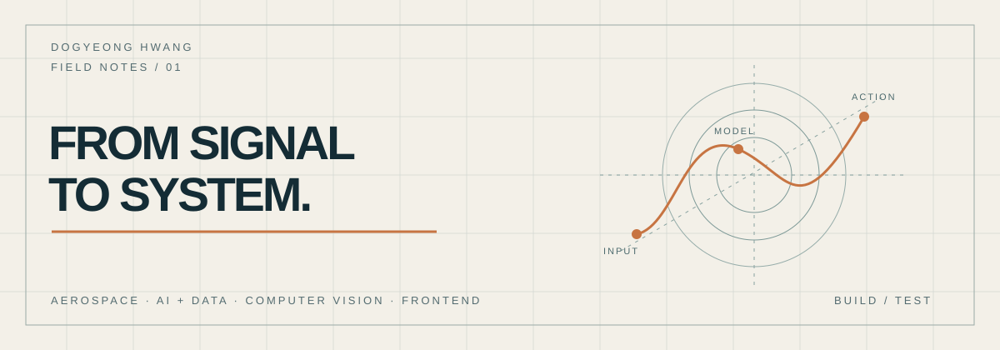

<picture>
  <source media="(prefers-color-scheme: dark)" srcset="https://raw.githubusercontent.com/ehrud7654/ehrud7654/master/assets/hero-dark.svg">
  <source media="(prefers-color-scheme: light)" srcset="https://raw.githubusercontent.com/ehrud7654/ehrud7654/master/assets/hero-light.svg">
  
</picture>

 

**Dogyeong Hwang · 황도경**  
**Rooted in avionics, working across AI, data, computer vision, and frontend.**  
항공전자공학 전공 | AI·데이터·컴퓨터 비전·프론트엔드

---

### Selected work

| 01 / ROADY | 02 / Physical AI |
| :--- | :--- |
| [**Edge → Server AI**](https://github.com/ehrud7654/roady-edge-server-ai) **AI** — Dataset building and labeling, the Jetson edge detection and server segmentation models, an obstacle detection model, and Jetson deployment prep. 데이터 구축·라벨링, Edge 탐지·서버 Segmentation 모델, 장애물 탐지 모델, Jetson 배포 준비 [Team project ↗](https://github.com/ehrud7654/ROADY) | [**UMI Robot Learning**](https://github.com/ehrud7654/physical-ai-umi-learning) **AI · FRONTEND** — Designed and built the web frontend for data, training, and task management; processed UMI demonstrations into training data; ran my own behavior-cloning baseline experiments. 데이터·학습·작업 관리 웹 프론트엔드 설계·구현, UMI 시연 데이터 처리, 개인 BC 기준선 실험 [Team project ↗](https://github.com/ehrud7654/Physical-AI-project) |

| 03 / OLA | 04 / Dancing with DMZ |
| :--- | :--- |
| [**Mountain Safety**](https://github.com/ehrud7654/OLA) **FRONTEND · AI** — Built the SafeLink feature and the frontend UI/UX, and integrated the AI features. 세이프링크 시스템, 프론트엔드 UI/UX 전반, AI 연동 | [**Radar Storytelling ↗**](https://github.com/htjworld/dancing-with-dmz) **FRONTEND LEAD** — Took on the frontend design and built the night-sky film and explore sections at the NASA Space Apps Challenge 2026. [Live app ↗](https://htjworld.github.io/dancing-with-dmz/) NASA Space Apps Challenge 2026 · 프론트엔드 디자인, 밤하늘 필름·탐색 화면 구현 · 팀 원본 저장소 연결 |

### Awards

- **2026 · Minister of Employment and Labor Award** — SSAFY × Kakao Tech Bootcamp AI Hackathon, Golden Time (DRIFT). [Repository ↗](https://github.com/Seongmiin2/DRIFT)  
  고용노동부 장관상 · 골든타임 팀(DRIFT)
- **2026 · Best Project Team** — SSAFY first-semester project competition, OLA. [Project ↗](https://github.com/ehrud7654/OLA)  
  SSAFY 1학기 프로젝트 경진대회 최우수팀 · 올라 팀
- **2026 · Excellence Award** — SSAFY common project, ROADY. [Project ↗](https://github.com/ehrud7654/ROADY)  
  SSAFY 공통 프로젝트 우수상 · ROADY 팀
- **2024 · Excellence Award** — Hanseo University Capstone Design Competition, 팜하니 (smart farm).  
  한서대학교 캡스톤디자인 경진대회 우수상 · 팜하니 팀(스마트팜)

More about each project is in its repository. A separate portfolio page is on the way. 프로젝트별 자세한 내용은 각 저장소에서 볼 수 있습니다. 별도 포트폴리오 페이지는 준비 중입니다.
